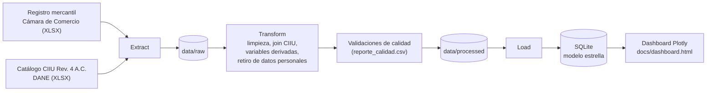
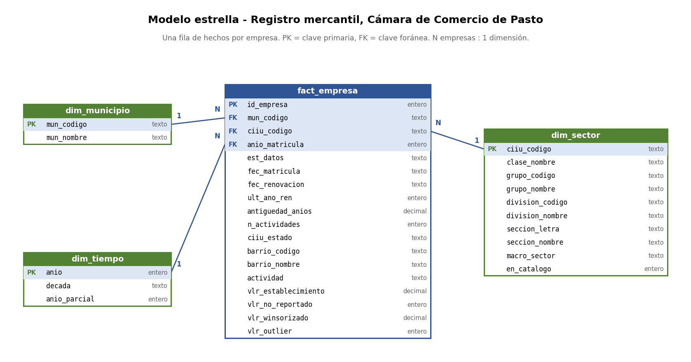
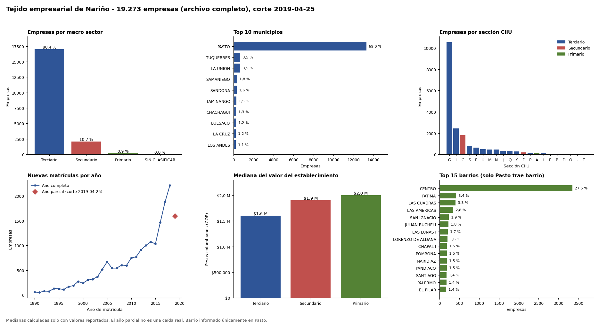

# Dinámica y carácter del Tejido Empresarial de Nariño con base en el Registro Mercantil de la Cámara de Comercio de Pasto

> Pipeline ETL que toma el registro mercantil de la Cámara de Comercio de Pasto (19.273 empresas) y la clasificación CIIU del DANE, los limpia, integra y anonimiza, y los deja en una base SQLite con modelo estrella y en un dashboard interactivo.

**Curso:** ETL — Maestría en Inteligencia Artificial y Ciencia de Datos, Universidad Autónoma de Occidente  
**Periodo:** 2026-2  
**Docente:** Fernando Barraza Alvarado

> **Privacidad:** el registro mercantil original contiene datos personales de los propietarios y **no se publica**. Este repositorio incluye una muestra anonimizada de 1.000 registros con la que el pipeline se puede ejecutar completo (ver [sección 6](#6-instalación-y-configuración)).

## Integrantes

| Nombre | Código | Usuario de GitHub |
|---|---|---|
| Gabriel Luciano Muñoz Cupacán | [PENDIENTE: código estudiantil] | [PENDIENTE: @usuario] |

## Tabla de contenido

1. [Descripción del problema](#1-descripción-del-problema)
2. [Fuentes de datos](#2-fuentes-de-datos)
3. [Arquitectura del pipeline](#3-arquitectura-del-pipeline)
4. [Estructura del repositorio](#4-estructura-del-repositorio)
5. [Requisitos](#5-requisitos)
6. [Instalación y configuración](#6-instalación-y-configuración)
7. [Ejecución](#7-ejecución)
8. [Detalle de las etapas ETL](#8-detalle-de-las-etapas-etl)
9. [Modelo y diccionario de datos](#9-modelo-y-diccionario-de-datos)
10. [Calidad de datos y validaciones](#10-calidad-de-datos-y-validaciones)
11. [Resultados](#11-resultados)
12. [Limitaciones y trabajo futuro](#12-limitaciones-y-trabajo-futuro)
13. [Referencias](#13-referencias)

## 1. Descripción del problema

La Cámara de Comercio de Pasto administra el registro mercantil de las empresas de su jurisdicción (Pasto y 40 municipios más de Nariño). Sin embargo, la base se entrega como un listado plano de 19.273 registros con códigos de actividad económica (CIIU) y de municipio sin traducir, sin agrupación por sector ni territorio, y con problemas de calidad que impiden usarla directamente: un código de estado de matrícula sin diccionario documentado, valores de establecimiento con outliers extremos (hasta $666.121 millones frente a una mediana de $1,6 millones) y campos que mezclan código y texto en una misma celda.

Esto dificulta que la Cámara, la Alcaldía de Pasto o la Gobernación de Nariño respondan preguntas básicas de planeación: ¿qué sectores económicos predominan?, ¿dónde se concentra la actividad empresarial?, ¿qué municipios tienen baja presencia de empresas formales? Estos actores usarían los datos resultantes para priorizar programas de fomento y formalización empresarial.

**Objetivo:** construir un pipeline ETL que integre el registro mercantil con la clasificación CIIU Rev. 4 A.C. del DANE, limpie y estandarice los datos, y los deje cargados en una base SQLite con modelo dimensional (hechos de empresas y dimensiones de municipio, sector y tiempo), junto con un dashboard interactivo de Plotly para el análisis sectorial y territorial.

## 2. Fuentes de datos

| Fuente | Tipo | Origen / URL | Tamaño aprox. | Frecuencia de actualización | Licencia |
|---|---|---|---|---|---|
| Registro mercantil, Cámara de Comercio de Pasto | XLSX | Archivo suministrado por la Cámara de Comercio de Pasto para uso académico del curso (sin URL pública) | 19.273 filas × 25 columnas (3,6 MB); 41 municipios | Extracto puntual con corte al 25-abr-2019; no se actualiza | Uso académico autorizado. Contiene datos personales: no se publica, solo una muestra anonimizada |
| Clasificación CIIU Rev. 4 A.C. (estructura detallada 2020), DANE | XLS (convertido a XLSX en el repositorio) | https://www.dane.gov.co/index.php/sistema-estadistico-nacional-sen/normas-y-estandares/nomenclaturas-y-clasificaciones/clasificaciones/clasificacion-industrial-internacional-uniforme-de-todas-las-actividades-economicas-ciiu | 717 filas × 4 columnas (185 KB): 21 secciones, 88 divisiones, 246 grupos, 499 clases | Por resolución del DANE (2012, 2020, 2021, 2022) | Información pública oficial del DANE; se cita la fuente |

**Llave de integración:** el código de 4 dígitos de `CIIU-1` (ej. `G4711` → `4711`) contra la columna `clase` del catálogo (relación muchos a uno).

**Nota de versiones:** los datos son de 2019 y el catálogo es la versión 2020, posterior a ellos. Ver las consecuencias en la [sección 12](#12-limitaciones-y-trabajo-futuro).

## 3. Arquitectura del pipeline



El pipeline sigue un enfoque **ETL** (no ELT). Extract copia los dos archivos de origen a CSV, con todos los campos como texto, sin interpretarlos. Transform aplana el catálogo CIIU, limpia el registro mercantil, lo cruza con el catálogo mediante un *left join*, crea las variables derivadas y retira las columnas con datos personales. Las validaciones corren dentro de Transform y Load y dejan sus conteos antes y después en `reporte_calidad.csv`. Load carga los datos en una base SQLite con modelo estrella, de la cual se alimenta el dashboard interactivo.

**Decisiones de diseño:**

- **ETL y no ELT:** la transformación debe ocurrir antes de la carga porque los datos personales no pueden llegar a la base, y porque los problemas de calidad (código de estado sin diccionario, formato mixto código-texto, outliers) se corrigen mejor antes de almacenar.
- **SQLite:** es un archivo único incluido en Python, no requiere servidor y permite que el pipeline corra en un entorno limpio con solo `pip install`; es suficiente para 19.273 registros.
- **Modelo estrella:** las consultas del dashboard son agregaciones por municipio, sector y tiempo, que es lo que una tabla de hechos con dimensiones resuelve mejor.
- **pandas:** el volumen es pequeño y cabe en memoria; no se justifica Spark ni una herramienta distribuida.
- **Etapas independientes:** cada etapa lee en disco lo que dejó la anterior, por lo que se pueden ejecutar por separado; si una falla, el pipeline se detiene.

**Tecnologías:** Python 3.11+, pandas, openpyxl, sqlite3 (biblioteca estándar), Plotly.

## 4. Estructura del repositorio

```
├── data
│   ├── raw                <- Datos de origen sin modificar (Extract agrega aquí copias en CSV que git ignora).
│   │   ├── muestra_anonimizada.xlsx                    <- 1.000 registros sin datos personales.
│   │   └── CIIU_Rev4AC_estructura_detallada_2020.xlsx  <- Catálogo CIIU del DANE (convertido a XLSX).
│   └── processed          <- Salidas del pipeline: CSV procesados, reporte de calidad y
│                             empresas.db (git los ignora; se regeneran con pipeline.py).
│
├── extract
│   └── extraer.py         <- Lee y valida las fuentes y las guarda como CSV de texto.
│
├── transform
│   └── transformar.py     <- Limpieza, join con CIIU, variables derivadas, retiro de datos
│                             personales y reporte de calidad.
│
├── load
│   ├── cargar.py          <- Carga a SQLite, validaciones posteriores a la carga.
│   └── esquema.sql        <- Modelo estrella: tablas, claves, restricciones y vista v_empresas.
│
├── dashboard
│   ├── datos.py           <- Agregados que se grafican (consultan la base).
│   └── construir_dashboard.py  <- Genera docs/dashboard.html con Plotly.
│
├── docs                   <- Documentación y evidencia.
│   ├── modelo_datos.png               <- Diagrama del modelo estrella.
│   ├── diccionario_datos.md           <- Diccionario de las 33 columnas del modelo.
│   ├── reporte_calidad.md             <- Verificaciones de calidad (muestra).
│   ├── reporte_calidad_archivo_completo.md  <- Verificaciones de calidad (archivo completo).
│   ├── resultados.png                 <- Figura de resultados (muestra).
│   ├── resultados_archivo_completo.png <- Figura de resultados (archivo completo).
│   └── dashboard.html                 <- Dashboard interactivo (lo genera pipeline.py).
│
├── tools                  <- Utilidades auxiliares (no forman parte del pipeline).
│   ├── crear_muestra_anonimizada.py   <- Genera la muestra anonimizada.
│   ├── generar_diccionario.py         <- Genera docs/diccionario_datos.md desde la base.
│   ├── generar_reporte_md.py          <- Convierte el reporte de calidad a Markdown.
│   ├── generar_figuras.py             <- Figura de resultados (requiere matplotlib).
│   └── dibujar_modelo.py              <- Diagrama del modelo (requiere matplotlib).
│
├── config.py              <- Rutas, esquema esperado y reglas compartidas por las etapas.
├── pipeline.py            <- Orquesta la ejecución completa (extract → transform → load → dashboard).
├── requirements.txt       <- Dependencias del proyecto.
├── .gitignore             <- Archivos que git debe ignorar (incluye los datos personales).
└── README.md              <- Este archivo.
```

Las carpetas `extract/`, `transform/`, `load/` y `dashboard/` son paquetes de Python (contienen un `__init__.py` vacío).

## 5. Requisitos

- Python 3.11 o superior
- SQLite (incluido en Python; no requiere instalación ni servidor)
- Dependencias listadas en `requirements.txt`: pandas, openpyxl y plotly
- Opcional, solo para regenerar las imágenes de `docs/` con `tools/`: matplotlib

No se necesita base de datos externa, cuenta en la nube ni Docker: el destino es un archivo SQLite que el propio pipeline crea. Se eligió así porque el volumen (19.273 registros) no justifica un servidor y porque permite reproducir el pipeline completo en un entorno limpio con solo `pip install -r requirements.txt`.

## 6. Instalación y configuración

```bash
# 1. Clonar el repositorio
git clone https://github.com/[PENDIENTE-usuario]/[PENDIENTE-repositorio].git
cd [PENDIENTE-repositorio]

# 2. Crear y activar el entorno virtual
python -m venv .venv
source .venv/bin/activate        # Windows: .venv\Scripts\activate

# 3. Instalar dependencias
pip install -r requirements.txt
```

En macOS o Linux el intérprete puede llamarse `python3` en lugar de `python`.

### Variables de entorno

Este proyecto **no requiere variables de entorno**: el destino es un archivo SQLite local que no usa credenciales. El archivo `.env` está incluido en `.gitignore` solo como medida de precaución.

### Obtención de los datos

El registro mercantil contiene datos personales de los propietarios y **no se publica**. El repositorio incluye en `data/raw/`:

- `muestra_anonimizada.xlsx`: 1.000 registros al azar, con las mismas 25 columnas que el original pero con los datos personales vaciados y la razón social y la matrícula reemplazadas por seudónimos.
- `CIIU_Rev4AC_estructura_detallada_2020.xlsx`: catálogo CIIU del DANE.

**Si no tiene el archivo completo**, no haga nada: la etapa de extracción usa automáticamente la muestra y lo informa en pantalla.

**Si tiene el archivo completo** (suministrado por la Cámara de Comercio de Pasto), cópielo como `data/raw/PASTO.xlsx`. La extracción lo detecta y lo usa en lugar de la muestra. También puede indicar otro archivo con `python pipeline.py --fuente RUTA`.

La muestra se genera con `python tools/crear_muestra_anonimizada.py RUTA_AL_EXCEL` (semilla fija: el resultado es reproducible).

## 7. Ejecución

```bash
# Pipeline completo (Extract -> Transform -> Load -> Dashboard), desde la raíz del repositorio
python pipeline.py

# Con el archivo completo en otra ubicación
python pipeline.py --fuente RUTA/AL/ARCHIVO.xlsx

# Solo el ETL, sin generar el dashboard
python pipeline.py --sin-dashboard
```

Cada etapa también puede ejecutarse por separado (leen lo que dejó la anterior):

```bash
python extract/extraer.py
python transform/transformar.py
python load/cargar.py
python dashboard/construir_dashboard.py
```

**Salida esperada:**

| Archivo | Contenido |
|---|---|
| `data/raw/registro_mercantil_extraido.csv` | Copia del registro mercantil, todo como texto |
| `data/raw/ciiu_extraido.csv` | Catálogo CIIU leído |
| `data/processed/empresas_procesadas.csv` | Registros limpios, sin datos personales |
| `data/processed/ciiu_aplanado.csv` | Catálogo CIIU aplanado (una fila por clase) |
| `data/processed/reporte_calidad.csv` | Conteos y validaciones antes/después |
| `data/processed/empresas.db` | Base SQLite con el modelo estrella |
| `docs/dashboard.html` | Dashboard interactivo (se abre con doble clic) |

Al iniciar, el pipeline indica en pantalla si usa el archivo completo o la muestra anonimizada. Cada ejecución reemplaza las salidas anteriores. Si una etapa del ETL falla, el pipeline se detiene con un mensaje claro y código de salida 1; si falla solo el dashboard (por ejemplo, porque Plotly no está instalado), se avisa y el ETL, que sí terminó, no se invalida.

**Tiempo aproximado** (equipo de pruebas): alrededor de 1 s con la muestra y entre 5 y 8 s con el archivo completo; la mayor parte es leer el Excel.

## 8. Detalle de las etapas ETL

### 8.1 Extract

- **Qué hace:** lee el registro mercantil (archivo completo o muestra anonimizada) y el catálogo CIIU del DANE, valida que tengan el esquema esperado (25 columnas el registro; 4 el catálogo) y guarda una copia de cada uno en CSV con todos los campos como texto. Se lee como texto para no perder los ceros iniciales de los códigos CIIU (0111 → 111), que impedirían el cruce con el catálogo. No corrige datos.
- **Scripts:** `extract/extraer.py` (rutas y esquema en `config.py`)
- **Salida:** `data/raw/registro_mercantil_extraido.csv`, `data/raw/ciiu_extraido.csv` y `data/raw/extraccion_meta.json`

### 8.2 Transform

- **Qué hace:** convierte el registro extraído en una tabla limpia, enriquecida con el catálogo CIIU y sin datos personales, y genera el reporte de calidad. Cada transformación responde a un hallazgo del análisis exploratorio.
- **Scripts:** `transform/transformar.py`
- **Salida:** `data/processed/empresas_procesadas.csv`, `data/processed/ciiu_aplanado.csv` y `data/processed/reporte_calidad.csv`

| # | Transformación | Justificación |
|---|---|---|
| 1 | Reemplazar la matrícula por un `id_empresa` técnico y eliminar duplicados por matrícula | La matrícula es un identificador directo. Duplicados encontrados: 0, pero la regla queda como control |
| 2 | Separar código y texto en municipio (`52001 - PASTO`), barrio (`00633 - Parque Bolívar`) y CIIU (`G4711 ** ...`) | Formato mixto en una misma celda: impedía agrupar y cruzar |
| 3 | Convertir fechas AAAAMMDD a fecha real; calcular antigüedad y año de matrícula | Las fechas venían como enteros |
| 4 | Marcar el año de corte como parcial (`anio_parcial`) | 2019 tiene 1.594 matrículas incompletas por la fecha de corte; evita leerlo como una caída |
| 5 | Dejar `EST_DATOS` como categoría sin interpretar (nulos como `SIN DATO`) | No existe diccionario oficial del código |
| 6 | Valor del establecimiento: marcar ceros como no reportado, winsorizar en P1-P99 y marcar outliers | Máximo de $666.121 millones frente a una mediana de $1,6 millones; 285 ceros; 19 valores menores a $1.000 |
| 7 | Resumir CIIU-2 a CIIU-4 en `n_actividades` | Tienen entre 59 % y 89 % de nulos |
| 8 | Normalizar texto (espacios, mayúsculas, tildes en NFC) | 6.381 actividades con espacios dobles |
| 9 | Eliminar teléfonos y correos escritos en texto libre | Apareció un número de celular como "actividad" |
| 10 | Aplanar el catálogo CIIU y hacer *left join* por código de 4 dígitos | Enriquecer con el sector; cobertura del 99,65 % sin perder registros |
| 11 | Etiquetar lo no clasificable como `SIN CLASIFICAR` en vez de eliminarlo | 65 empresas con códigos ausentes del catálogo 2020 y 2 sin CIIU |
| 12 | Retirar las 13 columnas con datos personales | Privacidad: nada personal llega a `processed` ni a la base |

### 8.3 Load

- **Qué hace:** carga los datos en una base SQLite con modelo estrella (una tabla de hechos y tres dimensiones, ver sección 9). La carga es de **reemplazo y atómica**: la base se construye en un archivo temporal y solo reemplaza a la anterior si todo sale bien. El modelo se protege con claves primarias, claves foráneas y restricciones `CHECK`. Tras cargar, se verifican los conteos, las claves huérfanas, la integridad de la base y que los totales por macro sector coincidan con el CSV de origen.
- **Scripts:** `load/cargar.py` y `load/esquema.sql`
- **Destino:** `data/processed/empresas.db` (SQLite)

### 8.4 Dashboard

- **Qué hace:** consulta la vista `v_empresas` y genera una página interactiva con 6 indicadores y 6 gráficos. Resume el valor del establecimiento con la **mediana** (el promedio, aun winsorizado, sigue distorsionado), marca el año parcial y limita el gráfico de barrios a Pasto, único municipio que trae ese dato.
- **Scripts:** `dashboard/datos.py` (agregados) y `dashboard/construir_dashboard.py` (Plotly)
- **Salida:** `docs/dashboard.html`, un archivo autocontenido que se abre con doble clic y no requiere servidor ni conexión a internet.

## 9. Modelo y diccionario de datos



| Tabla | Tipo | Contenido (cifras con el archivo completo) |
|---|---|---|
| `fact_empresa` | Hechos | Una fila por empresa o establecimiento (19.273) |
| `dim_municipio` | Dimensión | Un municipio (42: los 41 de la jurisdicción y `SIN DATO`) |
| `dim_sector` | Dimensión | Una clase CIIU con su jerarquía hasta macro sector (503: 499 del catálogo, 3 ausentes de él y `SIN CLASIFICAR`) |
| `dim_tiempo` | Dimensión | Un año de matrícula (57, de 1963 a 2019) |
| `v_empresas` | Vista | Hechos con sus dimensiones ya unidas; la consume el dashboard |

**Tabla / archivo:** `fact_empresa`

| Columna | Tipo | Descripción | Ejemplo |
|---|---|---|---|
| `id_empresa` | entero · PK | Identificador técnico, asignado por el orden de la empresa en el archivo de origen. No es la matrícula mercantil (que se elimina por ser un identificador directo). | `5` |
| `mun_codigo` | texto · FK → dim_municipio.mun_codigo | Municipio del establecimiento (código DIVIPOLA de 5 dígitos). `00000` = sin dato. | `52001` |
| `ciiu_codigo` | texto · FK → dim_sector.ciiu_codigo | Actividad económica principal (CIIU-1), clase de 4 dígitos. `0000` = sin clasificar. | `5611` |
| `anio_matricula` | entero · FK → dim_tiempo.anio | Año en que se matriculó la empresa. | `2018` |
| `est_datos` | texto | Código de estado de la matrícula tal como viene en la fuente (1, 2, 4, 6, 7, 8 o `SIN DATO`). La fuente no trae diccionario oficial, por eso **no se interpreta** su significado. | `6` |
| `fec_matricula` | texto | Fecha de la matrícula mercantil (AAAA-MM-DD). | `2018-01-09` |
| `fec_renovacion` | texto | Fecha de la renovación más reciente (AAAA-MM-DD). | `2019-01-14` |
| `ult_ano_ren` | entero | Último año en que la empresa renovó su matrícula. | `2019` |
| `antiguedad_anios` | decimal | Años transcurridos entre la matrícula y la fecha de corte de la extracción (renovación más reciente del archivo), con un decimal. | `1.3` |
| `n_actividades` | entero | Cantidad de actividades económicas registradas (1 a 4). Resume CIIU-1 a CIIU-4, que tenían entre 59 % y 89 % de nulos. | `4` |
| `ciiu_estado` | texto | Resultado del cruce con el catálogo CIIU: `ok`, `codigo_no_encontrado` (el registro trae un código que el catálogo 2020 no tiene) o `sin_ciiu`. | `ok` |
| `barrio_codigo` | texto | Código del barrio (5 dígitos). **Solo Pasto trae barrio**: en los otros 41 municipios es nulo por diseño de la fuente, no por datos faltantes. En Pasto, el 91,8 % de las empresas lo informa. | `600.0` |
| `barrio_nombre` | texto | Nombre del barrio, en mayúsculas y sin espacios dobles. Nulo fuera de Pasto (ver `barrio_codigo`). | `LAS AMERICAS` |
| `actividad` | texto | Descripción de la actividad en texto libre, normalizada. Se eliminan teléfonos y correos si aparecen escritos. | `EXPENDIO A LA MESA DE COMIDAS PREPARADAS` |
| `vlr_establecimiento` | decimal | Valor del establecimiento declarado, en pesos colombianos (COP), sin modificar. | `10000000.0` |
| `vlr_no_reportado` | entero | 1 si el valor es cero o nulo (se trata como dato no reportado, no como un valor real); 0 en caso contrario. | `0` |
| `vlr_winsorizado` | decimal | Valor recortado a los percentiles 1 y 99 de los valores reportados. Nulo si no se reportó. Aun así es muy asimétrico: para resumir, **usar la mediana** y no el promedio. | `10000000.0` |
| `vlr_outlier` | entero | 1 si el valor reportado está fuera del rango P1-P99; 0 en caso contrario. | `0` |

El diccionario completo de las 33 columnas, con las tres dimensiones, está en [`docs/diccionario_datos.md`](docs/diccionario_datos.md). Se genera con `python tools/generar_diccionario.py` leyendo la base real, y falla si una columna queda sin descripción. Los ejemplos corresponden a una misma empresa de la muestra anonimizada.

## 10. Calidad de datos y validaciones

Cada ejecución del pipeline genera `data/processed/reporte_calidad.csv` con las verificaciones de abajo. Resultados con el archivo completo (19.273 registros); el detalle de las 29 verificaciones está en [`docs/reporte_calidad_archivo_completo.md`](docs/reporte_calidad_archivo_completo.md). Con la muestra las cifras son proporcionales ([`docs/reporte_calidad.md`](docs/reporte_calidad.md)).

| Verificación | Antes | Después |
|---|---|---|
| Número de registros | 19.273 | 19.273 |
| Registros duplicados (por matrícula) | 0 | 0 |
| Valores nulos en columnas clave (municipio, CIIU, fecha de matrícula) | 3 | 0 |
| Columnas con datos personales | 13 | 0 |
| Teléfonos o correos escritos en texto libre | 1 | 0 |
| Fechas de matrícula no interpretables | 0 | 0 |
| Registros perdidos en el join con CIIU | - | 0 |
| Códigos CIIU sin coincidencia en el catálogo | - | 65 empresas (3 códigos), conservadas como `SIN CLASIFICAR` |
| Valores del establecimiento en cero | 285 | 0 como valor real (marcados `vlr_no_reportado`) |
| Valor máximo del establecimiento (COP) | 666.121.541.996 | 5.005.741.431 |
| Registros marcados como outlier de valor | - | 346 marcados (fuera de P1-P99) |
| `ACTIVIDAD` con espacios dobles | 6.381 | 0 |
| Registros: CSV procesado → fact_empresa | 19.273 | 19.273 |
| Claves foráneas huérfanas | - | 0 |

**Controles que detienen el pipeline** (no solo informan): un join que altere el número de registros, registros perdidos en Transform, un catálogo CIIU que no se pueda aplanar, y en Load: conteos distintos entre el CSV y la base, claves foráneas huérfanas, fallo de `integrity_check` o macro sectores que no coinciden.

## 11. Resultados

El pipeline carga los 19.273 registros en una base SQLite con modelo estrella y genera un dashboard interactivo (`docs/dashboard.html`) con los mismos agregados que la figura de abajo. Hallazgos principales con el archivo completo:

- **Concentración territorial:** el 69,0 % de las empresas está en Pasto; le siguen Tuquerres y La Unión con 3,5 % cada una.
- **Perfil sectorial:** el 88,4 % pertenece al sector terciario (comercio y servicios), el 10,7 % al secundario y el 0,9 % al primario. La sección G (comercio) concentra por sí sola 10.551 empresas.
- **Tamaño económico:** la mediana del valor del establecimiento es de $1,6 millones (terciario), $1,9 millones (secundario) y $2,0 millones (primario).
- **Dinámica:** las nuevas matrículas crecen de forma sostenida hasta 2018 (2.215); 2019 aparece incompleto por la fecha de corte y no es una caída real.

```sql
-- Empresas por macro sector (consulta sobre el modelo estrella)
SELECT s.macro_sector, COUNT(*) AS empresas
FROM fact_empresa f
JOIN dim_sector s ON s.ciiu_codigo = f.ciiu_codigo
GROUP BY s.macro_sector
ORDER BY empresas DESC;
-- Terciario 17.034 | Secundario 2.057 | Primario 180 | SIN CLASIFICAR 2
```



El dashboard se abre con doble clic en `docs/dashboard.html` (no requiere servidor). Con la muestra anonimizada se genera la misma figura en [`docs/resultados.png`](docs/resultados.png).

## 12. Limitaciones y trabajo futuro

**Limitaciones de los datos**

- **Es una fotografía, no una serie.** El registro tiene fecha de corte 25-abr-2019; no refleja la situación actual ni permite medir cancelaciones a lo largo del tiempo. El año 2019 queda con matrículas incompletas y se marca como parcial.
- **El estado de la matrícula (`EST_DATOS`) no tiene diccionario.** Por eso no se puede afirmar qué proporción de empresas está activa o cancelada, y la variable se conserva sin interpretar.
- **Desfase de versiones de la CIIU.** Los datos son de 2019 y el catálogo usado es la versión 2020; el DANE ha publicado actualizaciones posteriores. El 0,34 % de las empresas (65) trae códigos que ese catálogo no tiene como clase: 63 son el código 7110, que el catálogo 2020 desagrega en 7111 y 7112. Se conservan como `SIN CLASIFICAR` a nivel de clase, con su división, grupo y sección.
- **El barrio solo existe para Pasto.** Cualquier análisis barrial aplica únicamente a la capital (el 91,8 % de sus empresas lo informa).
- **El valor del establecimiento es autodeclarado y muy asimétrico.** Incluye valores de $0,10 y $1 y de hasta $666.121 millones. La winsorización en P1-P99 es una decisión analítica; aun así el promedio sigue por encima de la mediana, por lo que el dashboard usa medianas.
- **El macro sector es una convención** basada en la sección CIIU (A-B primario, C-F secundario, G-U terciario).

**Limitaciones del pipeline**

- **Las pruebas fueron manuales.** Los controles duros están en el código, pero el repositorio no incluye pruebas automáticas (`tests/`).
- **La carga es de reemplazo**, no incremental: cada ejecución reconstruye la base.
- **La anonimización de la muestra** elimina identificadores directos y se verificó buscando patrones, pero no es una garantía formal: combinaciones de valor, barrio y actividad podrían permitir reconocer a una empresa grande. Por eso el archivo completo no se publica.
- **Compatibilidad.** Se desarrolló y probó con Python 3.12 y pandas 3.0; los mínimos declarados (Python 3.11, pandas 2.2) no se ejecutaron.

**Trabajo futuro**

- Obtener de la Cámara de Comercio el diccionario de `EST_DATOS` para construir indicadores de formalización y cancelación.
- Incorporar una tabla de correspondencia entre versiones de la CIIU (2012, 2020, 2022) para clasificar los 65 registros restantes.
- Repetir la extracción periódicamente para tener una serie de tiempo y una carga incremental.
- Cruzar con población del DANE para calcular empresas por cada 1.000 habitantes.
- Agregar pruebas automáticas con `pytest` e integración continua (GitHub Actions).
- Agregar filtros por municipio y sector al dashboard.

## 13. Referencias

- Cámara de Comercio de Pasto. Registro mercantil (archivo suministrado para el curso ETL, corte 25-abr-2019). Contiene datos personales; no se publica.
- DANE. *Clasificación Industrial Internacional Uniforme de todas las actividades económicas (CIIU) Rev. 4 adaptada para Colombia.* https://www.dane.gov.co/index.php/sistema-estadistico-nacional-sen/normas-y-estandares/nomenclaturas-y-clasificaciones/clasificaciones/clasificacion-industrial-internacional-uniforme-de-todas-las-actividades-economicas-ciiu (se usó el archivo "Estructura detallada CIIU Rev. 4 A.C. 2020").
- DANE. *CIIU Rev. 4 A.C. (2022).* Documento de actualización, Resolución 2306 de 2022. https://www.dane.gov.co/files/sen/nomenclatura/ciiu/CIIU_Rev_4_AC2022.pdf
- Documentación de las herramientas: pandas (https://pandas.pydata.org), openpyxl (https://openpyxl.readthedocs.io), SQLite (https://www.sqlite.org), Plotly (https://plotly.com/python).
- Uso de IA generativa: se empleó Claude (Anthropic) como apoyo para el diseño del pipeline, la escritura y depuración del código, la documentación y la redacción de las pruebas. Las decisiones de alcance (fuentes, destino, tipo de dashboard, tratamiento de datos personales) las tomó el autor, y los resultados se contrastaron con el archivo original.
